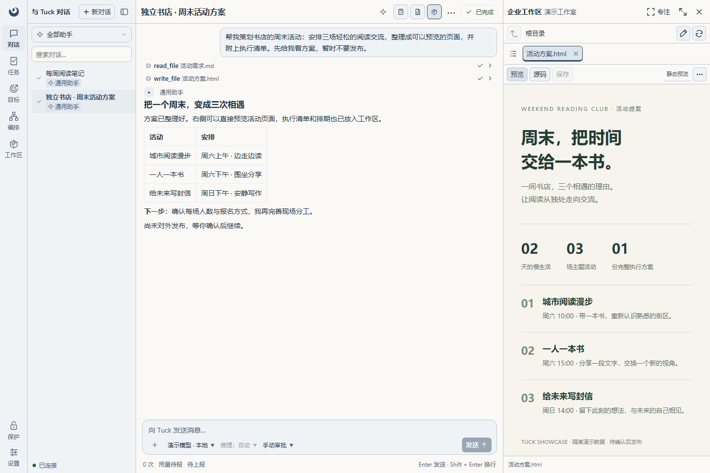
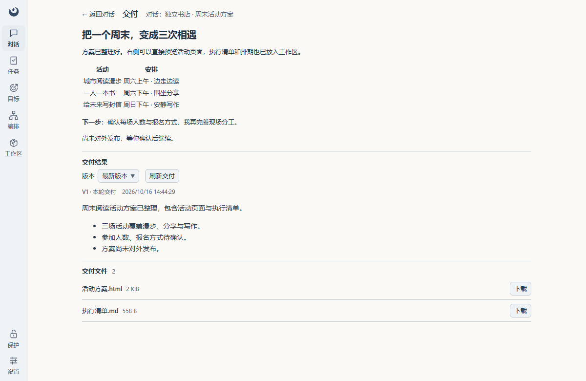
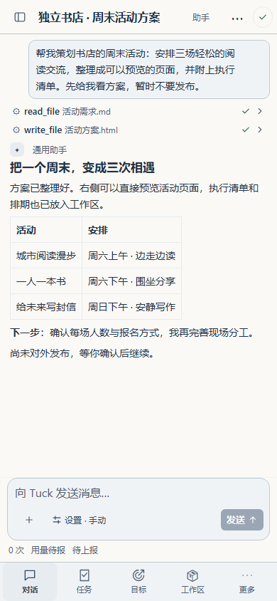
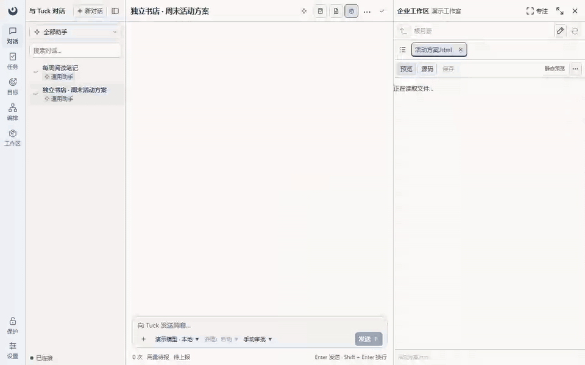
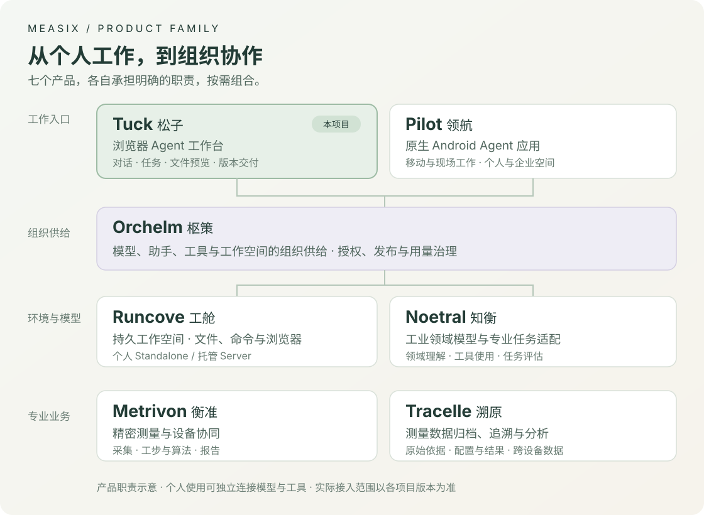

<div align="center">

# Measix Tuck · 松子

**把 Agent 的执行力，变成看得见、接得住的工作成果。**

基于 [Docker Agent](https://github.com/docker/docker-agent) 的自托管 Web 工作台。<br>
从个人助手到组织工作入口，在一处对话、跟进任务、查看文件、确认交付。

[快速开始](#快速开始) · [界面与能力](#tuck-的工作台体验) · [项目指引](#项目指引) · [Measix 产品体系](#measix-七大产品) · [开发与贡献](CONTRIBUTING.md)

</div>



<p align="center"><sub>当前版本实拍；会话、模型与企业文件服务采用隔离演示数据。</sub></p>

## Tuck 的工作台体验

给助手一个任务，带上资料，查看它调用工具的过程；需要你决定时处理审批或补充信息，完成后直接检查文件和交付。Tuck 把这条工作流程放进浏览器，让个人 Agent 能进入日常工作。

- **交流和执行在一起。** 流式对话、工具过程、原生审批、结构化提问与子代理上下文，遇到需要介入的步骤时沿原任务继续。
- **多个任务有处可看。** 按助手集中查看任务、待处理请求和交付；Tuck 服务运行期间，关闭浏览器后任务仍可执行，回来继续查看。
- **文件就是工作的一部分。** 附件与任务目录承接输入输出；企业工作区支持文本和源码编辑，以及 Markdown、HTML、CSV、PDF、图片、音视频预览。
- **在对话中生成图片。** 配置 OpenAI 兼容生图资源后，助手可通过工具生成 1–4 张图片；兼容标准 Images Edits 的服务还可使用 0–4 张参考图。图片进入对话并保留原文件，可继续检查和交付；设置与限制见 [文生图资源](docs/configuration.md#文生图资源)。
- **成果可以保留和核对。** 交付包含摘要、版本和文件快照，后续改动源文件也不会改变已保存版本；可回看、切换和下载。
- **桌面做事，手机跟进。** 响应式界面与可直达的对话、消息、文件和设置地址，让查看进展、回应请求和继续工作更方便。

<p>
  <a href="docs/assets/readme/delivery.png"></a>
  <a href="docs/assets/readme/mobile.png"></a>
</p>

交付页集中呈现回答、摘要与文件；手机浏览器也能查看同一任务的过程和结果。点击图片可查看原图。

<details>
<summary>观看操作演示：预览 → 源码 → 工作区 → 交付</summary>



真实浏览器操作录屏，使用同一组隔离演示数据。

</details>

## 从个人助手到组织工作入口

### 独立使用：自己的模型、工具和工作资料

配置模型供应商与 MCP，选择助手和工作目录，就可以开始资料整理、内容创作、脚本处理或报告制作。Go 后端和 Vue 前端由自己部署，任务记录和工作资料保存在自己的环境中；模型请求发往所配置的服务。

比如，把活动需求交给助手，生成页面和执行清单，再逐项确认；或者上传资料，让助手整理摘要、运行工具并提交报告。模型、工具、工作目录与权限共同决定任务能完成到哪一步。配置入口见 [模型、助手与工作目录](docs/configuration.md#模型助手与工作目录)。

### 连接 Runcove：给 Agent 一个持久工作环境

[**Measix Runcove · 工舱**](https://github.com/topabomb/measix-runcove) 提供持久文件、命令执行、浏览器、云桌面和临时 Web 发布。Tuck 承接任务与人机交互，Runcove 承接远端工作环境：Agent 在空间中处理资料、使用浏览器、生成产物，人可以进入 Runcove 桌面查看和接管。

个人部署可选择 **Runcove Standalone**，通过 Tuck 的 **设置 → MCP** 接入其 `/mcp` 地址，配置访问凭据和允许使用的助手/工具。工作文件留在 Runcove 空间中，可继续使用其桌面与文件入口。这种组合面向 Personal Agent 的持续资料整理、网页操作和内容生产场景。

部署与凭据以 [Runcove 指南](https://github.com/topabomb/measix-runcove/blob/main/docs/deployment.md) 为准，Tuck 侧见 [MCP 配置](docs/configuration.md#本地-mcp-工具选择)。**MCP 接入提供工具能力；本 README 展示的内置企业文件面板，还需要下面的 Orchelm 工作区接入。**

### 接入 Orchelm：组织供给能力，员工在端侧完成工作

**Measix Orchelm · 枢策** 管理组织的模型、助手、工具与工作空间。Tuck 通过平台生成的接入材料获得授权资源，在同一个工作台中完成对话、工具调用、审批、文件处理和交付，成为组织 Agent 面向员工的一类完整端侧实现。

平台身份、模型准入和工具许可继续生效；企业工作区按平台授权连接文件服务，可与 Runcove 托管空间组合。管理员维护能力供给，员工在 Tuck 中使用并检查结果。接入方式与边界见 [配置合同](docs/configuration.md) 和 [平台与安全](docs/architecture.md#平台与安全)。

## Docker Agent 与 Tuck

[Docker Agent（曾用名 cagent）](https://docs.docker.com/ai/docker-agent/) 是 Docker 团队开源的 Agent 构建与运行框架，可用 YAML 定义模型、指令、工具与协作关系，支持多模型供应商、内置工具及 MCP。它本身已有功能丰富的 [终端界面](https://docker.github.io/docker-agent/features/tui/)。

**Docker Agent 提供执行基础，Tuck 提供浏览器中的完整工作流程。** 原生会话上下文、审批、子代理与 MCP 生命周期交给官方引擎；Tuck 通过公开接口连接，增加任务视图、文件交互、版本交付与 Measix 平台接入。项目独立维护，兼容基线和具体职责见 [架构](docs/architecture.md#docker-agent-合同)。

**当前范围：** 单用户工作台，支持人工发起并持续跟进任务；目标和编排频道仍为占位入口，尚无目标调度、定时任务或主动提醒执行器。服务重启会收束中断执行，不会自动续跑旧任务。企业能力需要对应平台授权，Tuck 也未覆盖 Docker Agent 的全部配置功能。

## 快速开始

### 从源码运行

需要 Go 1.26、Node.js 22.17+ 和 pnpm 10.15.1。在仓库根目录执行：

```powershell
npm run setup
npm run build
npm start
```

打开 <http://127.0.0.1:8090/>，在设置中配置模型供应商，或提交平台生成的企业接入材料，再创建对话。初始配置没有模型凭据。

`setup` 安装依赖、仅在配置不存在时初始化，并下载及校验官方 Docker Agent；需要网络访问。`build` 构建前后端，`start` 运行已构建程序。前端热更新和测试见 [贡献指南](CONTRIBUTING.md)。

### 运行打包产物

使用项目打包脚本生成的发行包时，解包后在发行目录执行；Windows 使用 `.\tuck.exe`，Linux 使用 `./tuck`：

```powershell
.\tuck.exe init
.\tuck.exe engine install
.\tuck.exe serve
```

发行运行无需 Go 或 Node.js。容器安装、外部引擎、升级和回退见 [运行与发布](docs/deployment.md)。

## 项目指引

| 想做什么 | 从这里开始 |
| --- | --- |
| 配置模型、助手和 MCP | [配置指南](docs/configuration.md) |
| 了解工具及文件操作 | [工具参考](docs/tools-reference.md) |
| 部署、备份或升级 | [运行与发布](docs/deployment.md) |
| 理解项目职责和引擎边界 | [架构说明](docs/architecture.md) |
| 参与开发、运行测试或查找详细文档 | [贡献指南](CONTRIBUTING.md) |

默认只监听本机回环，开放局域网访问前须设置登录密码；配置、凭据和工作资料由部署者保管。问题和建议可提交到 [GitHub Issues](https://github.com/topabomb/measix-tuck/issues)，请提供版本、复现步骤和脱敏日志。

## Measix 七大产品

Measix 将个人与组织的 Agent 工作，连接到持久环境、专业模型和工业业务。下图介绍七大产品的职责；实际接入范围以各项目版本和部署组合为准。



- **工作入口：** 松子 **Tuck** 是浏览器 Agent 工作台；领航 [**Pilot**](https://github.com/topabomb/measix-pilot) 是原生 Android Agent 应用，面向移动与现场工作。
- **能力与治理：** 枢策 **Orchelm** 管理组织的能力供给、授权与用量；工舱 **Runcove** 提供持久执行环境；知衡 **Noetral** 面向工业领域模型与任务适配。
- **专业业务：** 衡准 **Metrivon** 负责精密测量与设备协同；溯原 **Tracelle** 保存原始数据、配置、结果和报告，支持追溯与分析。

个人使用可以从 Tuck 开始，按需连接远端环境。已公开仓库：[**measix-tuck**](https://github.com/topabomb/measix-tuck) · [**measix-pilot**](https://github.com/topabomb/measix-pilot) · [**measix-runcove**](https://github.com/topabomb/measix-runcove)。

## 致谢

感谢 Docker 团队与 Docker Agent 社区提供并持续维护开放的 Agent 执行基础。Tuck 的原生运行能力建立在这项工作之上：

- [Docker Agent 源码](https://github.com/docker/docker-agent) · [官方文档](https://docker.github.io/docker-agent/) · [官方发行](https://github.com/docker/docker-agent/releases)。
- 前端初始渲染基础来自 [topabomb/demo1](https://github.com/topabomb/demo1/tree/34d103e496ddddeb0826130d6ef9f8a93d21a099)，感谢其长历史消息渲染与参考演练设计；来源和后续依赖补丁见 [前端说明](docs/frontend.md#来源与依赖补丁)。

## 许可

仓库目前没有项目级 `LICENSE`，尚未声明统一的开源许可。前端来源与依赖补丁见 [前端说明](docs/frontend.md#来源与依赖补丁)；项目许可需由维护者明确，不能以依赖或来源项目的许可代替。
